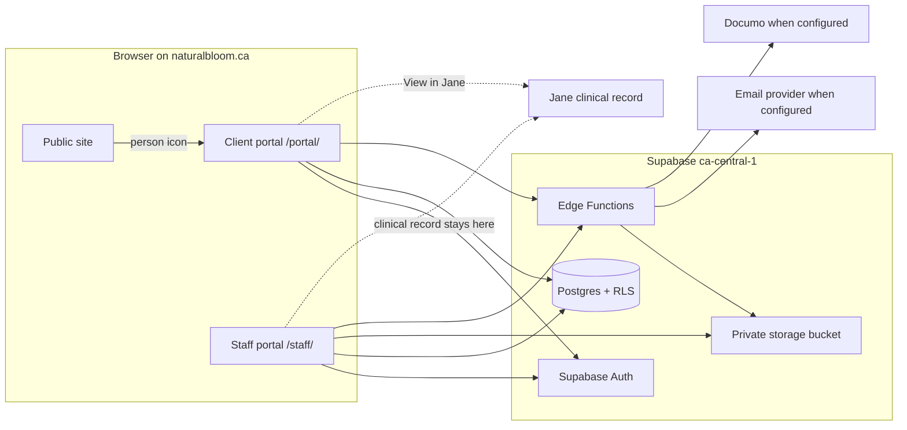

# Architecture

This note describes the testing build. It is not a statement that the system is HIA or PIPA compliant.

Jane is the clinical system of record. Supabase holds identity, the minimum demographics needed for a requisition, wellness notes that have a responsible clinician and NP approval, general education, and tracking the client types in. Lab results, diagnoses, medical history, clinical notes, prescriptions and NP treatment recommendations are not given tables in this database.

The public website stays a static GitHub Pages site. The person icon opens `/portal/`. Staff sign-in is `/staff/` and is not linked from the public navigation.
