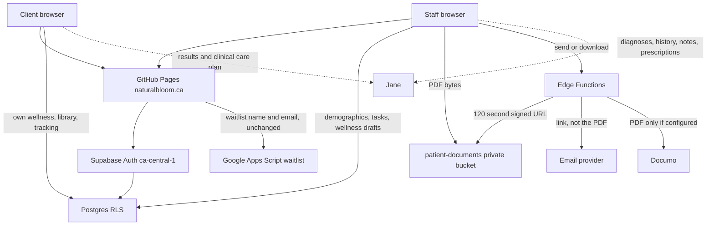

# Data flow

Jane, Supabase and the outside services, for the testing build. Legal review is still required before this is treated as an approved information flow.

What moves where:

| Flow | What moves | What does not move |
| --- | --- | --- |
| Client sign-in | Email and password to Supabase Auth | Chart contents |
| Client home | Profile, published wellness note, general ranges, library, own tracking | Lab values, diagnoses, prescriptions |
| Staff workspace | Names, city, masked health number, tasks, requisition status | Biomarker panels, clinical notes |
| PDF | A generated requisition record into the private bucket | An official AHS form that we pretend to be |
| Email | A link, then a confirmation code, both to the same mailbox | The PDF as an attachment |
| Fax | The PDF, only after Documo is configured | Anything when the secret is missing |
| Jane handoff | The browser opens the clinic’s Jane URL | A copy of the Jane chart |
| Waitlist | The existing Apps Script form | Health details. The form asks people not to include them |

The email confirmation code is sent to the same address as the link. That is not a separate channel. A person who can read the mailbox can read both. The trade-off is recorded in the readiness report.
